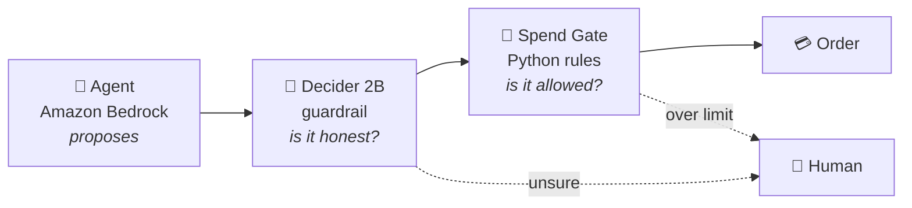

<!-- Profile README: lives in the public repo saintvisionary/saintvisionary -->

**Access control → Identity engineering**

*I secure AI agents, and I use AI agents to secure identity.*

---

### 🛡️ About me

- I work in **physical security and access control** (C•CURE 9000): badges, readers, door schedules, and who gets in where.
- I'm moving into **IAM / identity engineering**. The job is the same. The doors are now APIs, and many of the people walking through them are agents.
- My focus is **non-human identity**: giving AI agents their own identity, a human owner, least privilege, approval for risky actions, and a full audit trail.

### 🔑 Same controls, new doors

Everything I know from the physical side has an identity equivalent:

| Physical access control | Identity engineering |
|:---|:---|
| Badge | Credential / token |
| Card reader | Policy enforcement point |
| Access panel | Policy decision point |
| Clearance and door groups | Roles and permission sets |
| Door schedules | Conditional access |
| Two-person rule | Human-in-the-loop approval |
| Deactivate the badge on the last day | Deprovisioning (joiner-mover-leaver) |
| Event log and alarm monitoring | Audit log → SIEM |

---

### 🚀 Featured project

**[AI Agent Spend Gate](https://github.com/saintvisionary/AI-Agent-Spend-Gate):** *your AI agent has a company card. Here's what keeps it honest.*

- **Three layers of control.** The LLM proposes, Strands Decider 2B checks honesty (grounded, injected, mislabeled), and a deny-by-default rules engine decides permission.
- **Built for prompt injection.** A poisoned note in a tool result tries to buy gift cards. The guardrail denies it before the tool runs, and the rules would block it anyway.
- **Calibrated confidence.** Uncertain calls go to a human, not to a guess.
- **Reusable `#guardrails` pattern** that works with any Strands agent.

---

### 🧰 Toolbox

### 📜 Certifications

-6E7781?style=flat-square)
-6E7781?style=flat-square)

---

Least privilege for people, machines, and agents. 🔐

