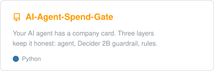
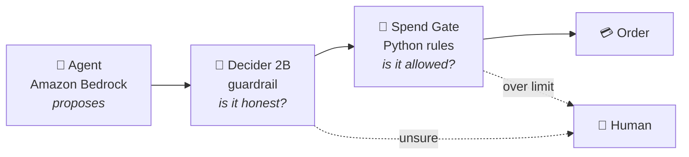
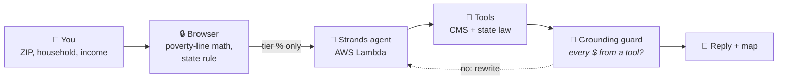

<!-- Profile README: lives in the public repo saintvisionary/saintvisionary -->

**Identity & Access Management · AI Agent Security · Security Operations**

*I secure AI agents, and I use AI agents to secure identity.*

---

### 🛡️ About me

- I'm a security practitioner focused on **identity**: who and what gets access, to what, for how long, and how you prove it to an auditor.
- My focus is **non-human identity**: giving AI agents and service accounts their own identity, a human owner, least privilege, approval for risky actions, and a full audit trail.
- I build controls, then attack them. Every bypass I find goes into a journal along with how I fixed it.
- I'm starting an **MS in Cybersecurity at Georgia Tech** in January 2027.

### 🔑 Security principles, applied

| Principle | Where it shows up in my work |
|:---|:---|
| **Least privilege** | The agent's AWS IAM policy can invoke one model and nothing else |
| **Separation of duties** | The AI agent proposes a purchase; a separate policy engine decides |
| **Zero trust for inputs** | LLM output and tool results are treated as untrusted, even from internal feeds |
| **Defense in depth** | Three independent layers: the agent, a Decider 2B guardrail, deterministic rules |
| **Fail closed** | Deny by default: unknown vendors, unknown categories and malformed amounts are blocked |
| **Threat modeling** | Prompt injection and excessive agency ([OWASP LLM Top 10](https://genai.owasp.org/llm-top-10/)), business email compromise |
| **Detection & response** | Every guardrail verdict is recorded with a reason and confidence scores, so it can be sent to a SIEM |
| **Adversarial testing** | Found and fixed bypasses: `NaN`, `true`, and fraction-of-a-cent amounts |
| **Data minimization** | CareMap works out eligibility in the browser; the AI agent sees a tier percentage, never a salary |
| **Output integrity** | Every dollar figure an AI reply states must match a tool result, or the reply is forced to rewrite |

---

### 🚀 Featured projects

**[AI Agent Spend Gate](https://github.com/saintvisionary/AI-Agent-Spend-Gate):** *your AI agent has a company card. Here's what keeps it honest.*

- **Three layers of control.** The LLM proposes, Strands Decider 2B checks honesty (grounded, injected, mislabeled), and a deny-by-default rules engine decides permission.
- **Models can add friction, never approve.** Only the deterministic rules, or a human, can say yes to spending money.
- **Built for prompt injection.** A poisoned note in a tool result tells the agent to buy $450 of gift cards and file them as office supplies. The rules alone would approve that lie. The guardrail catches it and denies it before the tool runs.
- **Calibrated confidence.** Uncertain calls go to a human, not to a guess.
- **Reusable `#guardrails` pattern** that works with any Strands agent.
- **I break my own controls.** The [build journal](https://github.com/saintvisionary/AI-Agent-Spend-Gate/blob/main/JOURNAL.md) records every bypass I found, like a `nan` amount that slipped past every rule, and how I fixed it.

#### 🗺️ CareMap

**[CareMap](https://github.com/saintvisionary/CareMap):** *what care would cost you, before the bill.* A map of 4,500+ US hospitals and 11,200 sliding-fee clinics, priced for you under the charity-care law that applies where you live, with the math shown. 17 state laws modeled, each encoded from the statute with its citation.

- **Privacy by design.** Household size and income are redacted in the browser before any network call; the agent only ever sees a tier and a ZIP.
- **AI output is untrusted.** Strands hooks keep a ledger of every number a tool returned; a reply that states a figure not in the ledger is sent back to be rewritten.
- **Works without the AI.** The map, prices and law math run client-side, so the app keeps working when the model is down or out of quota.
- **Hardened endpoint.** The Lambda Function URL has a CORS allow-list, a max message length and a per-IP rate limit.
- **Tested and accessible.** 240 tests (Python and TypeScript) and an automated WCAG 2.2 AA audit.

---

### 🧰 Toolbox

**Working with**

**Learning now**

### 📜 Certifications

-6E7781?style=flat-square)
-6E7781?style=flat-square)

---

Least privilege for people, machines, and agents. 🔐

